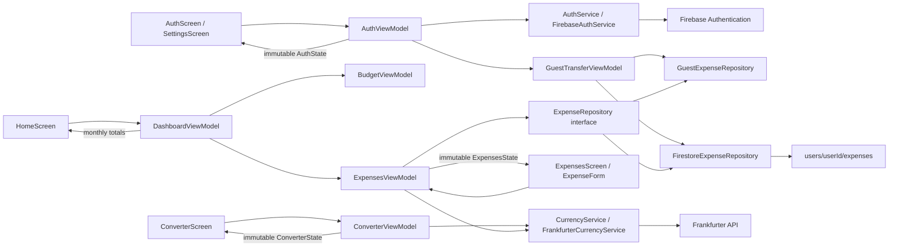

# Pockit

**Your money, wherever you go.**

Pockit is a Flutter personal-finance app for the CS 1635 MPX final project. It combines
multi-currency expense tracking, currency conversion, and monthly budget settings.
Home shows a monthly spending summary and animated budget progress. Category charts are next.

The app opens directly into guest mode. An account is optional; signing in enables
cloud storage and transfers expenses entered during the current guest session.

## Project status

| Phase | Status | Progress |
| --- | --- | --- |
| 1 — Foundation | Mostly complete | App theme, folder structure, navigation, and Firebase client configuration are implemented; repository setup and live configuration checks remain |
| 2 — Currency converter | Implemented | Eight currencies, conversion, swapping, rate dates, validation, loading, and retry |
| 3 — Expense tracking and accounts | Implemented; device verification remains | Expense CRUD, filters, gestures, Firestore streams, guest transfers, email/password authentication, and Google sign-in |
| 4 — Dashboard and budget | In progress | Monthly budget settings, spending totals, remaining balance, month selection, and animated progress are implemented; category charts are next |
| 5 — Polish and accessibility | In progress | Responsive navigation, improved expense cards, and automated tests and budget animations exist; final branding and accessibility checks remain |
| 6 — Submission | Planned | Screenshots, final documentation, project archive, and demo video |

“Implemented” describes code in the project, not confirmation that every live Firebase
setting or device flow has been manually verified.

## Implemented features

### App foundation

- Dark green and warm off-white Material theme with rounded controls and cards.
- Home, Expenses, Convert, and Settings tabs.
- Bottom navigation on smaller screens and a navigation rail on wider screens.
- Guest-first entry with a **Sign in** button in the top-right corner.
- Firebase startup loading and retry screens.
- Feature-separated models, services, repositories, ViewModels, views, and widgets.

### Expense tracking

- Add, edit, delete, and review expenses.
- Amount, currency, category, purchase date, and optional description fields.
- Fixed categories: Food, Shopping, Transportation, Entertainment, Travel, Bills, Other.
- Category filtering, newest-first ordering, and loading/error/empty states.
- Swipe-to-delete with confirmation and undo; visible edit/delete buttons are also available.
- Full-width responsive expense cards with category icons, purchase details, prominent
  original amounts, and USD conversions for foreign purchases.
- Integer minor-unit storage with currency-aware precision and half-up USD rounding.
- Saved original amount, converted USD amount, exchange rate, and effective rate date.
- Description/category-only edits preserve the saved conversion; amount, currency,
  or purchase-date changes recalculate it.
- Per-user Firestore documents and live `snapshots()` updates.

### Currency converter

- USD, EUR, GBP, JPY, KRW, CAD, AUD, and CNY.
- Source/destination selection, currency swapping, amount validation, and rate refresh.
- Converted amount and effective rate date.
- Loading indicators, error messages, and retry actions.
- Local calculation when the amount changes, without a request for every keystroke.
- Protection against older network responses replacing the latest selected pair.

### Accounts and guest mode

- Email/password registration and sign-in.
- Google sign-in on the account screen, using native mobile authentication or a Web popup.
- Password reset, session restoration, sign-out, and readable authentication errors.
- Account changes clear the previous account's screens, forms, and expense subscriptions.
- Guest expenses stay in memory without disk or cloud writes before authentication.
- Signing in or registering transfers guest expenses while preserving their conversions.
- Failed transfers retain pending purchases for retry while the app remains open.
- Transfer retries reuse document IDs to avoid duplicate purchases and stay tied to
  the account that started the transfer.

## Planned implementation

### Monthly budget and dashboard

- [x] Set and update one recurring monthly budget in USD with validation and saving feedback.
- [x] Save the budget in Firestore as integer USD cents with live updates.
- [ ] Persist the preferred entry currency in account settings.
- [x] Keep guest budgets in memory and transfer on sign-in, preserving an existing account budget.
- [x] Show monthly spending and remaining budget on Home.
- [x] Show the percentage of budget used with animated progress, over-budget status, and reduced-motion support.
- [ ] Include saved USD conversions in totals for foreign purchases.
- [x] Show the amount over budget when spending exceeds the limit.
- [x] Add previous/next month navigation and a shortcut to the current month.
- [ ] Add category spending breakdowns.
- [ ] Show recent expenses on Home.
- [x] Animate budget progress when spending, the budget, or the selected month changes.
- [x] Add the budget repository, ViewModel, Settings form, and owner-only validation rules.

### Remaining product work

- [ ] Add a converter action to create an expense from the entered amount and currency.
- [ ] Let users choose the preferred currency for new expense entries while reporting in USD.
- [x] Replace the Home placeholder with a monthly spending summary.
- [x] Add monthly budget editing to Settings.
- [ ] Add the preferred entry currency to Settings.
- [ ] Expand loading, empty, and error coverage for budget/dashboard features.
- [ ] Create the final app icon and launch screen.
- [ ] Check contrast, larger text, small screens, landscape, and screen-reader behavior.
- [ ] Manually verify Google authentication, guest transfers, and cloud sync on target platforms.

Historical exchange rates, receipt scanning, bank connections, category-specific
budgets, and multiple reporting currencies are outside the current MVP scope.

## Run the app

Use Flutter compatible with the Dart SDK constraint in `pubspec.yaml` (`^3.13.4`).
Firebase client configuration targets iOS, Android, and Web using project `pockit-90b0e`.

```sh
flutter pub get
flutter run -d chrome
```

For mobile, start an iOS simulator or Android emulator and select it with `flutter run`.
Fully stop and rebuild after adding native plugins; ordinary Dart UI changes can use
hot reload. macOS, Linux, and Windows are not configured Firebase targets.

### Dependencies

| Package | Purpose |
| --- | --- |
| `provider` | ViewModel ownership and reactive state binding |
| `http` | Frankfurter exchange-rate requests |
| `firebase_core` | Firebase initialization |
| `firebase_auth` | Account authentication and sessions |
| `cloud_firestore` | Per-account expense storage and live updates |
| `google_sign_in` | Native Google account authentication |
| `cupertino_icons` | iOS-style icon library |
| `shared_preferences` | Retained from the earlier local-storage prototype; current expenses use memory or Firestore |
| `flutter_test`, `flutter_lints` | Automated testing and static analysis |

## Firebase setup and checks

1. Enable Email/Password and Google in Firebase Authentication.
2. Create the default Cloud Firestore database.
3. Publish the contents of [firestore.rules](firestore.rules) in the Firestore Console's
   Rules tab, or review the rules and deploy them with:

   ```sh
   firebase deploy --only firestore:rules --project pockit-90b0e
   ```

4. Start the app, create an account, and add a USD expense. Check
   `users/{your Firebase UID}/expenses/{expenseId}` in Firestore.
5. Sign out and back in to verify persistence. Use another account to verify isolation,
   and another app window with the same account to verify live updates.
6. Add expenses as a guest, then sign in to verify they transfer successfully.

Rules allow the owning account to read/delete its expenses. Creates/updates also
validate field names, amount bounds, supported currencies, categories, description
length, dates, and the server-generated update timestamp. Other paths remain denied;
budget validation rules are included; preferred-currency rules will be added later. Local rule files do not change
the live database until published.

Firebase client configuration files contain app identifiers, not administrative
credentials. Never commit service-account credentials. Run `flutterfire configure`
to regenerate client options when changing projects or adding platforms.

### Google sign-in setup

The native client files have been refreshed and the iOS OAuth client ID and callback
URL scheme are configured in `ios/Runner/Info.plist`.

- **iOS:** Fully rebuild the app and verify the actual Google account chooser and callback.
- **Android:** Register the signing certificate SHA-1 for each build type in Firebase
  Project settings → Your apps → Android app → Add fingerprint, and refresh
  `android/app/google-services.json` if needed.
- **Web:** Verify the hostname, including localhost for local testing, is in Firebase
  Authentication's authorized domains and that the browser permits sign-in popups.

References: [Firebase federated authentication](https://firebase.google.com/docs/auth/flutter/federated-auth),
[Google sign-in iOS setup](https://pub.dev/packages/google_sign_in_ios),
[Google sign-in Android setup](https://pub.dev/packages/google_sign_in_android).

## Architecture



Models represent data. ViewModels own validation, state, and async orchestration.
Services handle authentication and HTTP calls; repositories handle expense storage.
Views bind to state through Provider. Each account has a separate workspace and
Navigator. Firestore subscriptions update expense state automatically.

Individual document writes avoid overwriting the entire expense list. Concurrent
edits to the same expense currently use last-write-wins behavior.

## Current behavior and limitations

- Rates come from the [Frankfurter API](https://frankfurter.dev/) at
  `https://api.frankfurter.dev/v2/rate/{base}/{quote}`, with a 15-second request timeout.
- Foreign purchases use the latest available daily reference rate, even for past
  purchase dates. The form discloses this and saves the effective rate date.
- Reference rates may differ from bank/card rates and fees.
- Firestore can show local changes before the server confirms a write. Saving may
  remain pending offline; reconnect and keep the app open to complete it.
- Guest expenses and failed transfer queues are held in memory. Closing/restarting
  the app before a successful upload loses those unsaved entries.
- Legacy expenses from the earlier device-storage prototype are not imported from
  shared preferences. This is separate from the implemented current-session guest transfer.
- Category charts, preferred entry currency, and the
  converter-to-expense shortcut are not implemented yet.

## Testing and validation

Latest recorded checks: **43 Flutter tests passed**, `flutter analyze` reported no
issues, and the iOS property-list files passed syntax validation. The Firestore rule
smoke tests previously passed in local emulators. These checks do not replace manual
Google OAuth or live-device testing.

```sh
flutter analyze
flutter test
```

The suite uses fake services and covers navigation, form validation, conversion,
swapping, failures/retries, currency precision, stored conversions, expense CRUD and
undo, live updates, account isolation, listener cleanup, guest sessions/transfers,
Google sign-in/cancellation, and Firestore document mapping.

For security-rule testing, install the Firebase CLI and use Python 3 and a Java
version supported by the Firebase emulators:

```sh
firebase emulators:exec --only auth,firestore --project demo-pockit 'python3 test/firestore_rules_smoke.py'
```

This uses a local demo project and temporary emulator accounts, checks owner CRUD,
rejects unauthenticated/cross-account access and invalid fields, and does not deploy
rules to the live project.

## Screenshots and demo

Screenshots/GIFs and the 3–5 minute demo video will be added after the dashboard,
budget, animation, and final branding are complete.

## Monthly budget settings

Settings now has one monthly limit in USD. It applies every month until changed.
Signed-in users store it at `users/{userId}/settings/preferences` as
`monthlyBudgetMinor`, with `reportingCurrency: USD` and a server update timestamp.
Guests keep the value in memory. On sign-in it is copied to the account only if no
budget is already saved. Failed transfers can be retried from Settings.

Publish the updated `firestore.rules` before testing cloud budget saves. Guest mode
works without publishing rules. Budget tests cover validation, exact cents, loading,
save failures, guest transfer, existing budgets, and isolation between accounts.

Suggested feature commit: `feat: add monthly budget settings`

## Monthly spending summary

Home shows total spending, expense count, the current monthly budget, and the
remaining balance for a selected month. Foreign purchases use their saved USD
conversions. Totals include all categories, even if the Expenses tab is filtered.
Use the arrows to switch months or **This month** to return to the current month.
The current recurring budget applies to every selected month; historical budget
limits are not stored. Expense and budget changes update the summary automatically.

Suggested feature commit: `feat: add monthly spending summary`

## Animated budget progress

The Home budget card shows the percentage used and animates the bar when spending,
the budget, or the selected month changes. Spending over the limit still shows the
actual percentage, while the bar stops at full. Text and icons distinguish within
budget, budget reached, and over budget. Screen readers receive the final percentage
and status; reduced-motion settings skip the animation.

Suggested feature commit: `feat: add animated budget progress`
