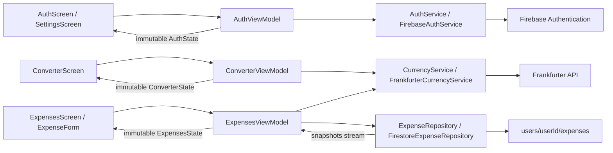

# Pockit

Your money, wherever you go. A Flutter personal-finance app for CS 1635 MPX.

## Current milestone

- Green and warm off-white theme, four tabs, and a navigation rail for wider windows.
- Guest-first app with optional sign-in from the top-right button.
- Email/password and Google sign-in, session restoration, password reset, and sign-out.
- Guest expenses live in memory and transfer automatically on sign-in or registration. Failed transfers can be retried while the app remains open.
- Currency converter for USD, EUR, GBP, JPY, KRW, CAD, AUD, and CNY with swap,
  effective rate dates, refresh, validation, loading, and retry states.
- Add/edit expenses, category filters, and swipe-to-delete with confirmation and undo.
- Per-account Cloud Firestore expense documents and stream-based updates.
- Original minor-unit amounts, fixed USD conversions, saved rates, and rate dates.
- Home and budget preferences remain for the dashboard/budget milestone.

## Run

Use Flutter compatible with the Dart SDK constraint in `pubspec.yaml`.
Firebase is configured for iOS, Android, and Web, using project `pockit-90b0e`.

```sh
flutter pub get
flutter run -d chrome
# Or select an iOS simulator / Android emulator with flutter run.
flutter analyze
flutter test
```

Fully stop and rerun after adding native Firebase plugins. macOS, Linux, and Windows
are not configured Firebase targets. Run `flutterfire configure` to add targets or
connect a different Firebase project.

Dependencies: Provider for state binding, HTTP for Frankfurter, Firebase Core,
Firebase Authentication, and Cloud Firestore. `shared_preferences` remains installed
from the earlier local-storage milestone; new expenses use Firestore.

## Firebase setup and security rules

1. Enable Email/Password in Firebase Authentication.
2. Create the default Cloud Firestore database.
3. Publish the contents of `firestore.rules` in the Firestore Console's Rules tab.
   Alternatively, review the rules and run:

   ```sh
   firebase deploy --only firestore:rules --project pockit-90b0e
   ```

4. Start Pockit, create an account, and add a USD expense. Look under
   `users/{your Firebase UID}/expenses/{expenseId}` in Firestore.
5. Sign out and back in to verify the expense returns. A second account should have
   its own empty list. A second app window signed into the same account receives
   expense changes through `snapshots()`.

Rules in this repository grant read/delete only to the path's authenticated owner.
Create/update also validate field names, integer amount bounds, supported currencies,
category, description length, timestamps, and a server-generated update timestamp.
Unmatched paths are denied. Budget/preferences rules will be added with that feature.
These local rules must be published to affect the live database; app code does not
publish them automatically.

Firebase client configuration in `lib/firebase_options.dart` contains public app
identifiers, not administrative credentials. Never commit service-account credentials.
The native iOS and Android client configuration files are also present. FlutterFire
can regenerate the Dart options file when configuration changes.

## Architecture



Models contain data. ViewModels own validation, state, and async orchestration.
Services own authentication/API calls; the repository owns document mapping and
Firestore operations. Widgets receive immutable state through Provider.
Guests use an in-memory repository with no disk or cloud writes.
Each authenticated account gets a separate workspace and Navigator. Changing accounts
or signing out disposes the old forms, ViewModels, and stream subscriptions.
Individual expense writes avoid overwriting the entire list when two devices edit
separate expenses. Concurrent edits to the same document use last-write-wins behavior.

## Amounts, rates, and connectivity

Frankfurter documentation: https://frankfurter.dev/
Endpoint: `https://api.frankfurter.dev/v2/rate/{base}/{quote}`. No API key is required.

Rates are daily reference rates; bank/card quotes and fees may differ. Requests have
a 15-second timeout. Amount edits calculate locally; currency-pair changes fetch a
rate, and stale responses are ignored.
Expenses use integer minor units and integer arithmetic with half-up USD rounding.
Foreign expenses use the latest available rate, even for past purchase dates, as
disclosed in the form. Description/category-only edits preserve the saved conversion;
amount, currency, or date changes recalculate it. Foreign entries require a successful
rate request. Firestore stores purchase/rate dates as timestamps and `updatedAt` as a
server timestamp.

Firestore can emit cached/local changes before server confirmation. Save completion
waits for the write to reach the backend, so it may remain pending offline. The user
can leave the form and see a syncing reminder in Settings; reconnect and keep the app
open to finish. Session restoration relies on Firebase Authentication's persistence.
Earlier device-only expenses remain in the old local preferences; they are not
silently uploaded or attributed to a newly signed-in account. Migration is not yet
implemented.

## Tests

```sh
flutter analyze
flutter test
```

Tests use fake authentication, currency, and expense services without live accounts.
They cover registration validation, auth failures, password-reset feedback, sign-out,
account isolation with open forms, cancellation of listeners, remote expense updates,
Firestore mapping, navigation, conversion and swapping, invalid amounts, retry,
narrow-screen text scaling, expense add/edit/delete/undo, minor-unit rounding,
preservation of conversions, filtering, and repository failures.

Test Firestore rules separately using the Firebase CLI, Python 3, and a Java version
supported by the Firebase emulators:

```sh
firebase emulators:exec --only auth,firestore --project demo-pockit 'python3 test/firestore_rules_smoke.py'
```

This command uses local emulator accounts and a demo project, not the live project.
It checks owner CRUD, denial of signed-out/cross-account access, and rejected malformed
expense fields. It does not deploy rules.

## Remaining submission work

Publish and verify rules in the live project, test on iOS/Android devices, GitHub
initialization and meaningful history, monthly budgets, dashboard, meaningful
animations, final icon and launch screen, screenshots, and a 3–5 minute demo video.
This milestone is not the complete MPX submission.

## Google sign-in

The account screen supports **Continue with Google** on both sign-in and registration.
iOS and Android use the official `google_sign_in` plugin and exchange the ID token for
a Firebase credential. Web uses Firebase's Google popup. Canceling the chooser leaves
the user in guest mode. Existing guest purchases transfer through the same account
transfer queue as email/password authentication.

Google is enabled in the Firebase console. The refreshed native client files are
included, and `ios/Runner/Info.plist` contains the iOS OAuth client ID and callback
URL scheme. Fully stop and rebuild after installing the plugin.

For Android, register your signing certificate SHA-1 in Firebase Project settings →
Your apps → Android app → Add fingerprint. Use the certificate for each build type
you test, then refresh `android/app/google-services.json` if required. The downloaded
configuration currently includes the web OAuth client used as the server client ID.
For Web, add the hostname you use (including localhost for local testing) to Firebase
Authentication's authorized domains if it is not already listed, and allow popups.

Setup references: https://firebase.google.com/docs/auth/flutter/federated-auth
and https://pub.dev/packages/google_sign_in_ios

Automated tests use a fake Google provider and do not open a real Google account
chooser. Verify the full OAuth flow manually on your simulator/device and browser.
